# SAVIA — examen N.º 1

Proyecto estático HTML + CSS para el restaurante ficticio SAVIA. No necesita dependencias, frameworks ni servidor.

## Cómo abrir y verificar el proyecto

1. Descargar el ZIP o clonar el repositorio: `git clone https://github.com/keyloor/EXAMEN-1`.
2. Abrir `index.html` en el navegador.
3. Navegar con el menú superior: Inicio, Nuestra carta (`pages/menu.html`) y Nuestro equipo (`pages/equipo.html`).
4. Para revisar la adaptación móvil, abrir las herramientas de desarrollador (F12), activar el modo dispositivo y probar con 1280 px y 375 px de ancho.

Estructura:

- `index.html`: página de inicio.
- `pages/menu.html` + `css/menu.css`: Feature 1, carta de tres tiempos.
- `pages/equipo.html` + `css/equipo.css`: Feature 2, equipo detrás de cada plato.
- `css/styles.css`: estilos generales del sitio.
- `images/`: imágenes del sitio y evidencias del README.

# Estudiantes

Keylor Barrantes Gómez - C5D024

Juan Pablo Jiménez Vargas - C5G323

## Diagnóstico de cinco incidencias

| N.º | Comportamiento observado                                | Causa técnica y ubicación                                                                                   | Corrección realizada                                                           | Prueba de verificación                                                        | Autor  |
| --- | ------------------------------------------------------- | ----------------------------------------------------------------------------------------------------------- | ------------------------------------------------------------------------------ | ----------------------------------------------------------------------------- | ------ |
| 1   | Las cards en column                                     | El flex direction, en el css feature layout estaba en column envez de row.        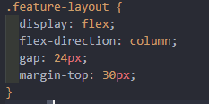| La dirección del flex la cambiamos a row.                                     | Guardamos y ejecutamos la vista de index.html             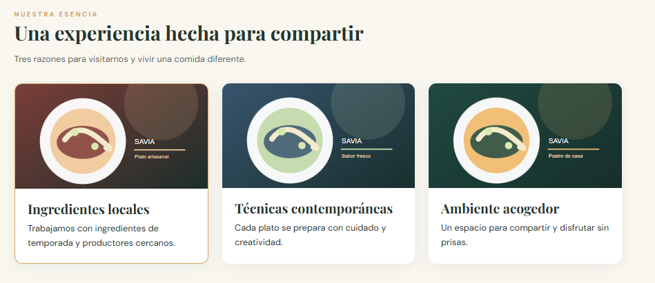                    | Keylor |
| 2   | Redirecciona a otra página                              | El anchor redireccionaba a eventos.  html      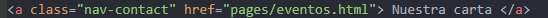                                               | Se cambio para que redireccione a menu.html                                    | Guardamos, ejecutamos y probamos el anchor             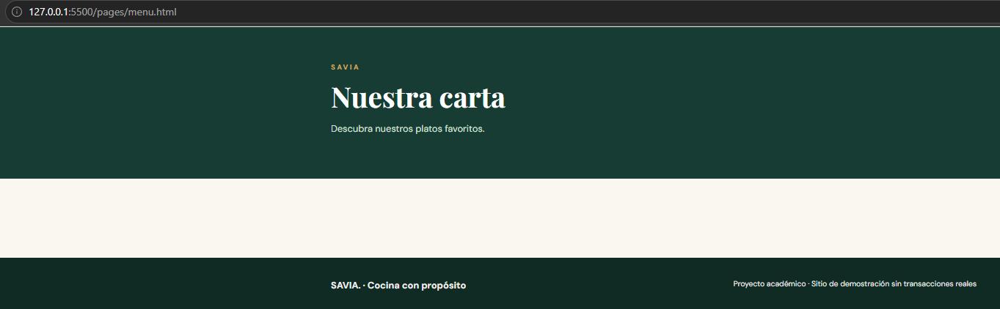                       | Pablo  |
| 3   | Redireccionaba a # osea se mantenia en la misma sección | El href estaba redireccionando a # envez de a pages/menu. html           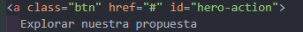                                    | Se cambio de # a pages/menu.html                                               | Guardamos, ejecutamos y probamos el btn nuevamente              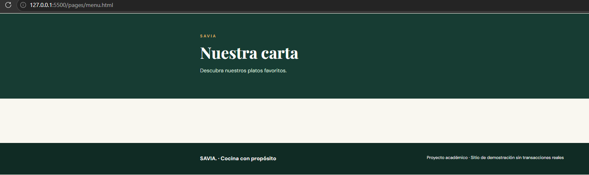              | Keylor |
| 4   | El color es rojo envez de dorado                        | En el css el #hero-action tenía un color distinto        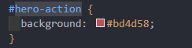                                                   | Se cambio el color por #d7a45b que corresponde a la paleta                     | Guardamos y vimos el boton                                 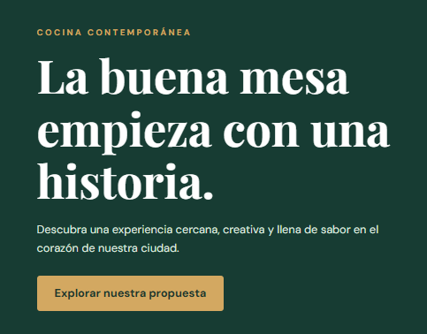                   | Pablo  |
| 5   | Los links no se movían abajo del logo                   | No había un media que indicara que al llegar a ese ancho el flex direction cambiara a column, estaba en row 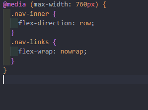| Se agrego un @media (max-width: 375px) que cambiara el flex direction a column | Guardamos, ejecutamos y inspeccionamos para ver si cambiaba al bajar el ancho 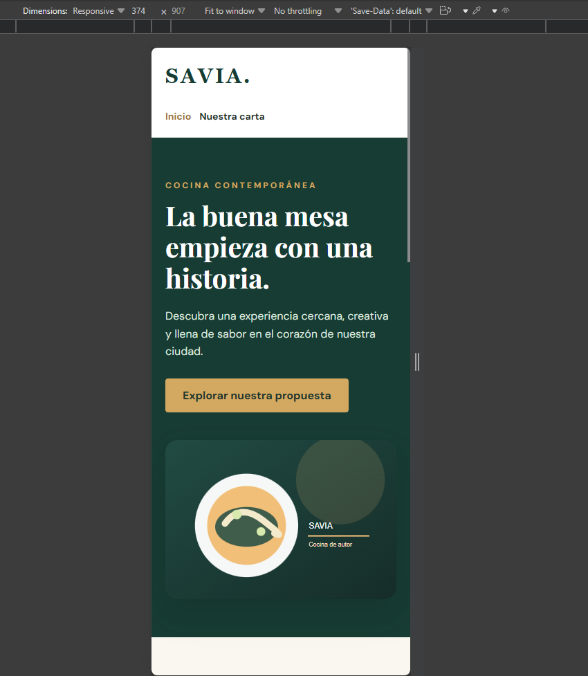 | Keylor |

## Responsables de las funcionalidades

| Estudiante | Página asignada                          | Rama   | Commits principales |
| ---------- | ---------------------------------------- | ------ | ------------------- |
| Pablo      | Carta interactiva: viaje de tres tiempos | pablo  | `08cee8d` Feature de menu, `53463a5` CSS propio y correcciones |
| Keylor     | Equipo: detrás de cada plato             | keylor | `d002746` Feature 2 Equipo, `228680d` CSS propio y correcciones |

## Evidencias Git

| Funcionalidad/corrección | PR hacia develop | Revisor | Resultado de merge / conflicto si ocurrió |
| ------------------------ | ---------------- | ------- | ----------------------------------------- |
| Parte A: corrección de incidencias | [PR #1](https://github.com/keyloor/EXAMEN-1/pull/1) (autor: Pablo) | Keylor | Merge automático, sin conflictos |
| Feature 1: Menú | [PR #2](https://github.com/keyloor/EXAMEN-1/pull/2) (autor: Pablo) | Keylor | Merge automático, sin conflictos |
| Feature 2: Equipo | [PR #4](https://github.com/keyloor/EXAMEN-1/pull/4) (autor: Keylor) | Pablo | Antes del PR se sincronizó develop en keylor (merge automático). Merge sin conflictos |
| Feature 2: CSS propio, correcciones y evidencias | [PR #5](https://github.com/keyloor/EXAMEN-1/pull/5) (autor: Keylor) | Pablo | Merge automático, sin conflictos |
| Feature 1: CSS propio, sección final y correcciones | [PR #6](https://github.com/keyloor/EXAMEN-1/pull/6) (autor: Pablo) | Keylor | pablo se sincronizó con develop antes del PR (incluía el PR #5). Merge automático, sin conflictos |

El [PR #3](https://github.com/keyloor/EXAMEN-1/pull/3) se abrió por error hacia `main` y se cerró sin fusionar. Se reemplazó por el PR #4 hacia `develop`.

### Capturas del merge de los PR

PR #1, Parte A:

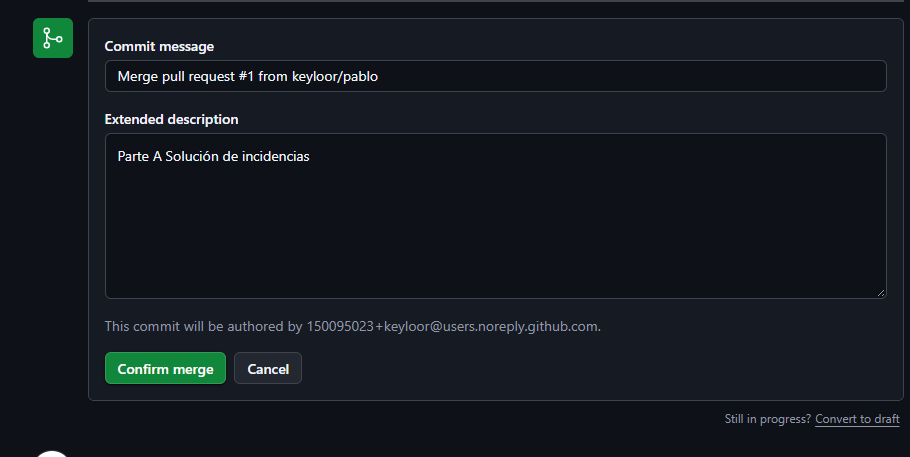

PR #2, Feature 1 (Menú):

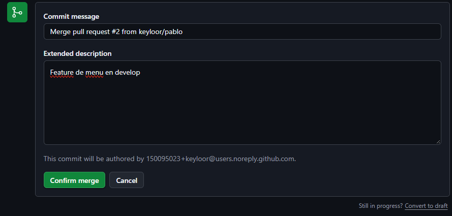

PR #5, Feature 2 (Equipo), fusionado por Pablo:

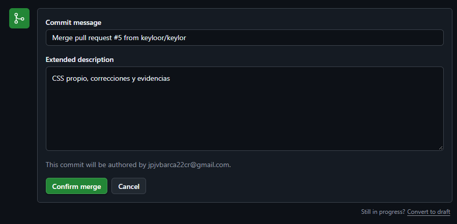

PR #6, Feature 1 (Menú), fusionado por Keylor:

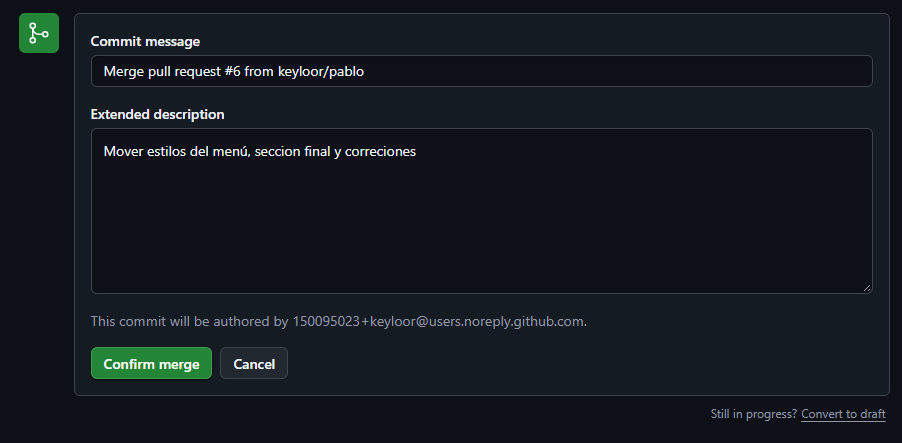

## Verificación final

Inicio a 1280 px:

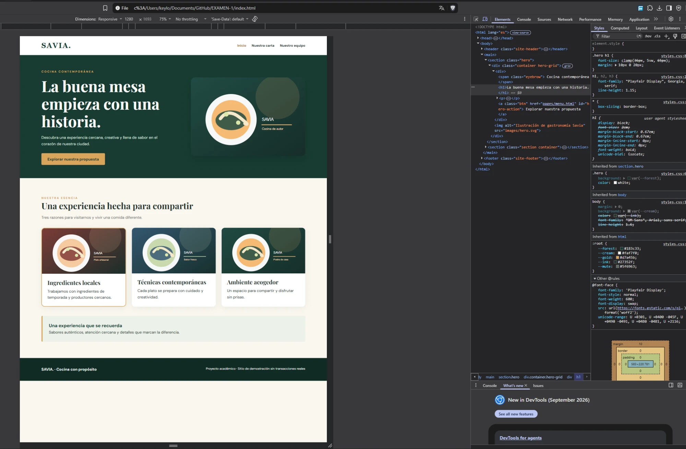

Inicio a 375 px:

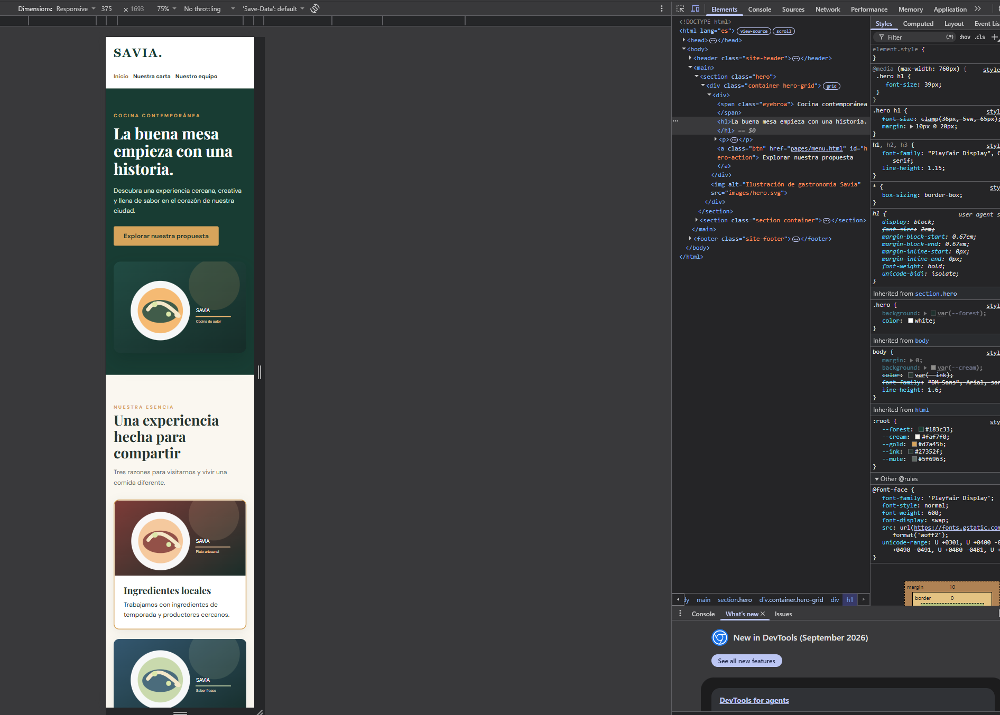
